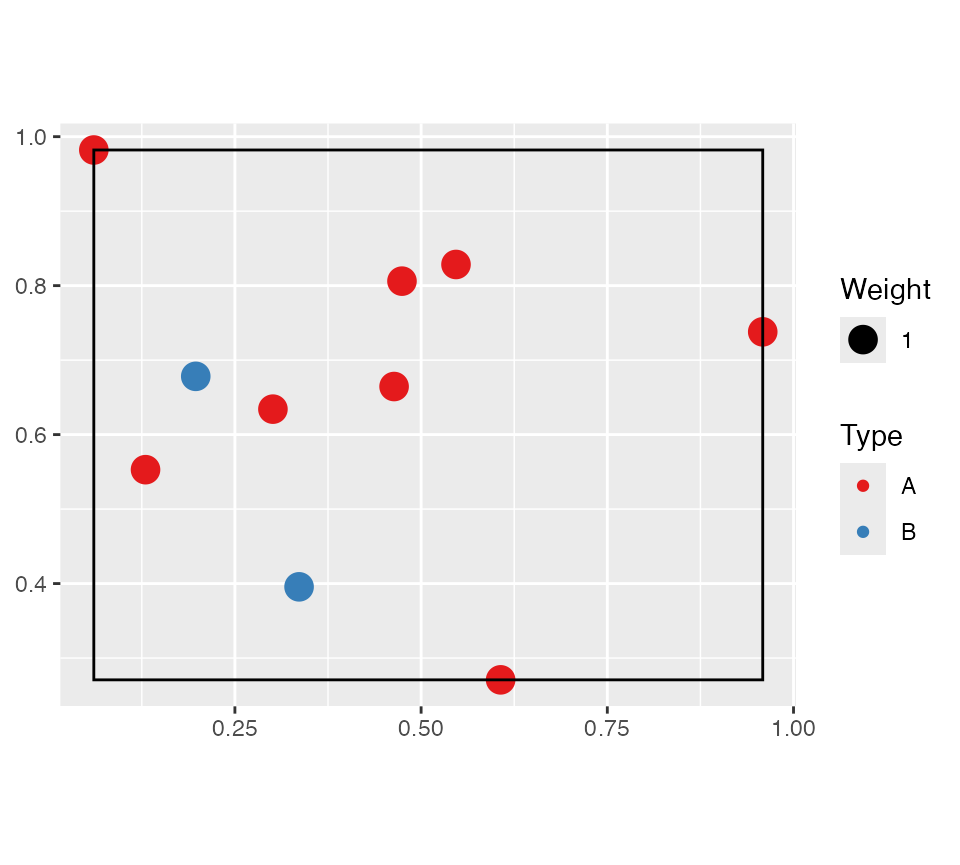
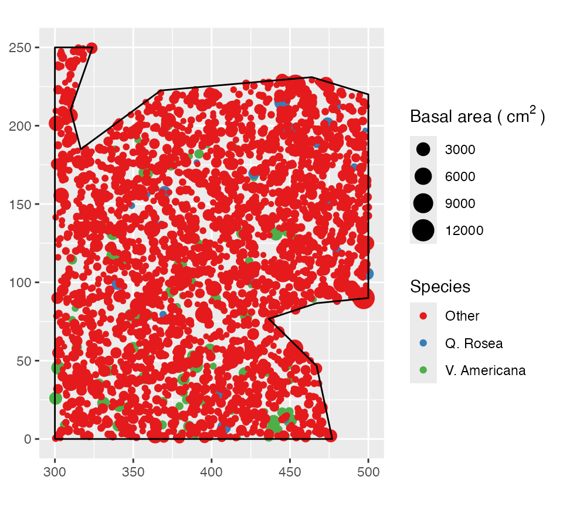
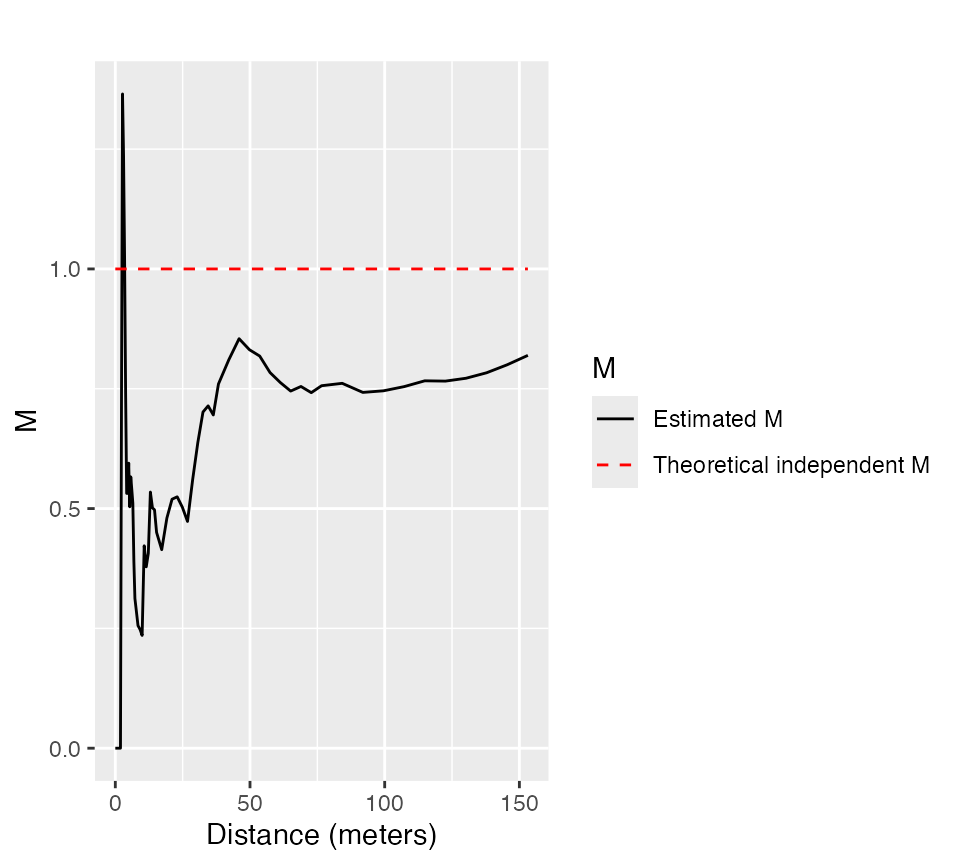
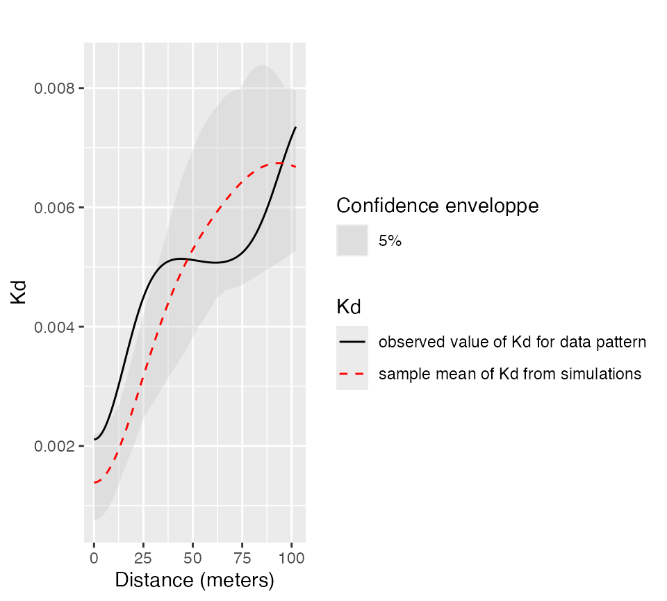
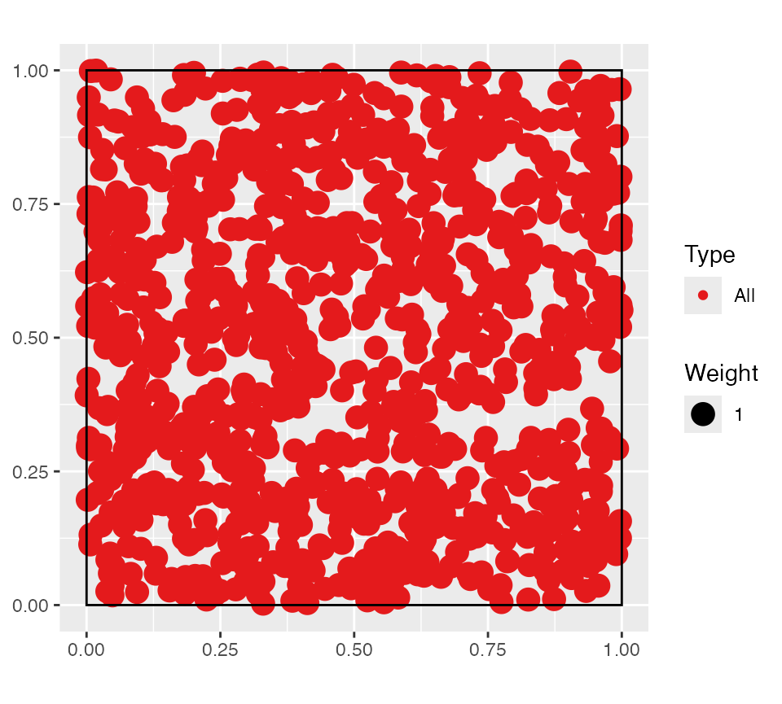
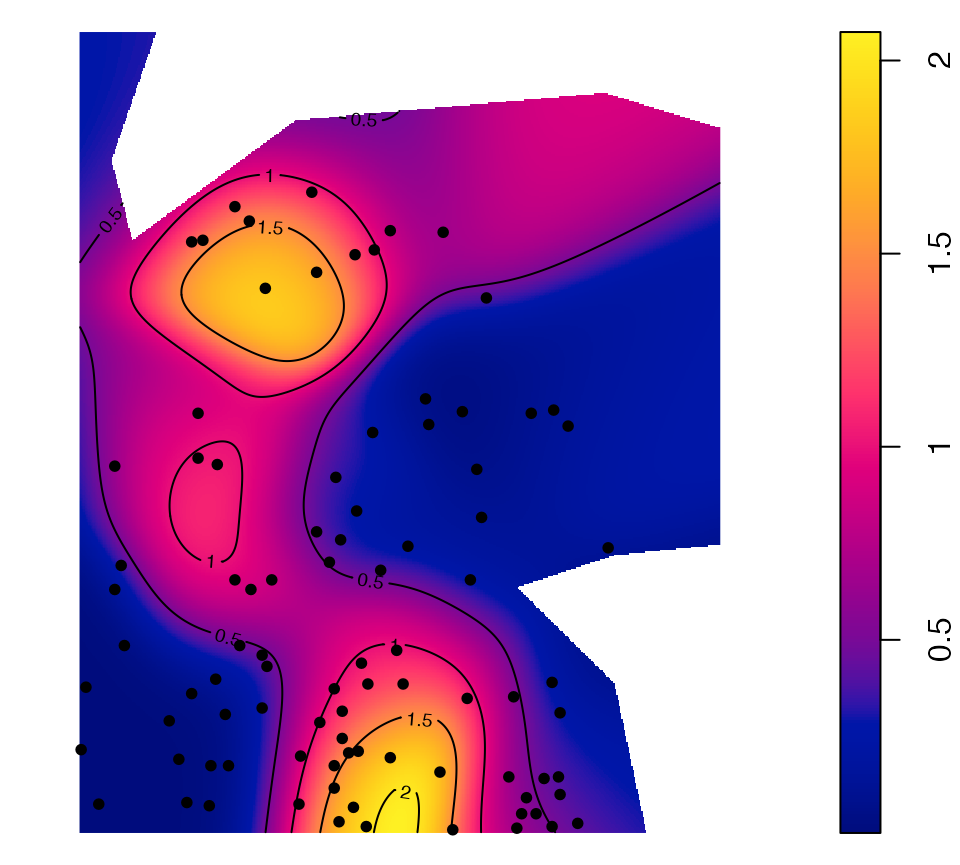

# dbmss

The *dbmss* package allows simple computation of spatial statistic
functions of distance to characterize the spatial structures of mapped
objects, including classical ones (Ripley’s K and others) and more
recent ones used by spatial economists (Duranton and Overman’s $`K_d`$,
Marcon and Puech’s $`M`$). It relies on *spatstat* for some core
calculation.

This vignette contains a quick introduction.

## Data

The main data format is `wmppp` for weighted, marked point pattern. It
inherits from the `ppp` class of the *spatstat* package.

A `wmppp` object can be created from the coordinates of points, their
type and their weight.

``` r

library("dbmss")
# Draw the coordinates of 10 points
X <- runif(10)
Y <- runif(10)
# Draw the point types.
PointType <- sample(c("A", "B"), size = 10, replace = TRUE)
# Plot the point pattern. Weights are set to 1 ant the window is adjusted
autoplot(wmppp(data.frame(X, Y, PointType)))
```



An example dataset is provided: it is a point pattern from the Paracou
forest in French Guiana. Two species of trees are identified, other
trees are of type “Other”. Point weights are their basal area, in square
centimeters.

``` r

# Plot (second column of marks is Point Types) 
autoplot(
  paracou16, 
  labelSize = expression("Basal area (" ~cm^2~ ")"), 
  labelColor = "Species"
)
```



## Main functions

The main functions of the package are designed to calculate
distance-based measures of spatial structure. Those are non-parametric
statistics able to summarize and test the spatial distribution
(concentration, dispersion) of points.

The classical, topographic functions such as Ripley’s *K* are provided
by the *spatstat* package and supported by *dbmss* for convenience.

Relative functions are available in *dbmss* only. These are the $`M`$
and $`m`$ and $`K_d`$ functions.

The bivariate $`M`$ function can be calculated for *Q. Rosea* trees
around *V. Americana* trees:

``` r

autoplot(
  Mhat(
    paracou16, 
    ReferenceType = "V. Americana", 
    NeighborType = "Q. Rosea"
  ), 
  main = ""
)
```



## Confidence envelopes

Confidence envelopes of various null hypotheses can be calculated. The
univariate distribution of *Q. Rosea* is tested against the null
hypothesis of random location.

``` r

p16_envelope <- KdEnvelope(paracou16, ReferenceType = "Q. Rosea", Global = TRUE)
autoplot(
  p16_envelope, 
  main = ""
)
```



Significant concentration is detected between about 10 and 20 meters.

Goodness of Fit tests are available to produce a p-value, i.e. the
probability to erroneously reject the null hypothesis.

``` r

# Test H0 up to 30m
GoFtest(p16_envelope, Range = c(0, 30))
```

    ## [1] 0.00990099

An analytical test, that does not rely on simulations, is available for
the K function against complete spatial randomness in a rectangular
window.

``` r

# Simulate a Poisson point pattern
X <- rpoispp(1000)
autoplot(as.wmppp(X))
```



``` r

# Test it
Ktest(X, r = seq(0.1, .5, .1))
```

    ## [1] 0.8457173

## Maps

Individual values of some distance-based measures can be computed and
mapped.

``` r

# Calculate individual intertype M(distance) value
ReferenceType <- "V. Americana"
NeighborType <- "Q. Rosea"
fvind <- Mhat(
  paracou16, 
  r = c(0, 30), 
  ReferenceType = ReferenceType, 
  NeighborType = NeighborType, 
  Individual = TRUE
)
# Plot the point pattern with values of M(30 meters)
p16_map <- Smooth(
  paracou16, 
  fvind = fvind, 
  distance = 30,
  # Resolution
  Nbx = 512, 
  Nby = 512
)
par(mar = rep(0, 4))
plot(p16_map, main = "")
# Add the reference points to the plot
is.ReferenceType <- marks(paracou16)$PointType == ReferenceType
points(
  x = paracou16$x[is.ReferenceType], 
  y = paracou16$y[is.ReferenceType], 
  pch = 20
)
# Add contour lines
contour(p16_map, nlevels = 5, add = TRUE)
```



## Full documentation

<https://ericmarcon.github.io/dbmss/>
