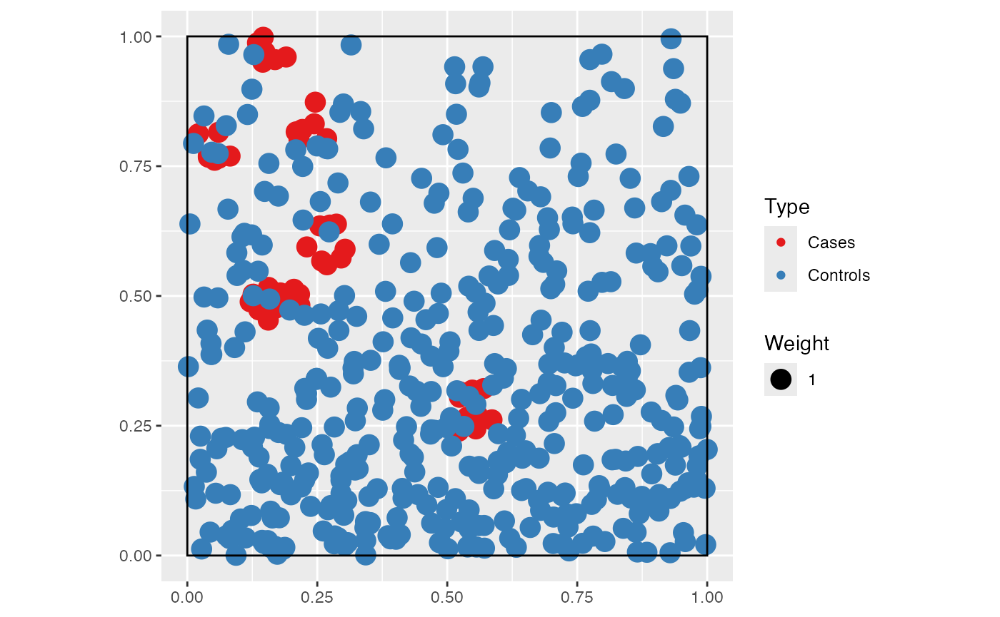
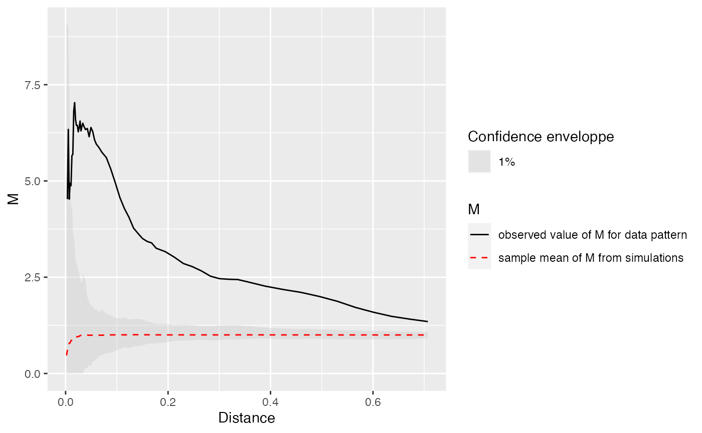
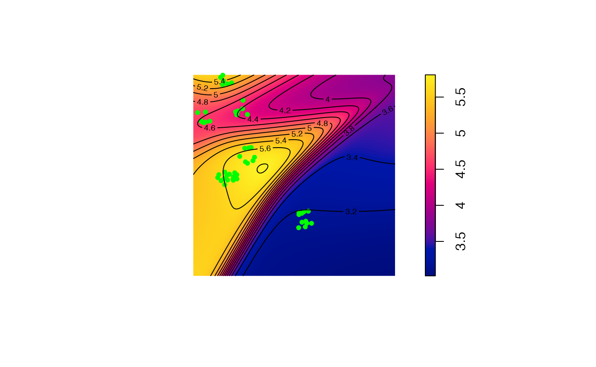
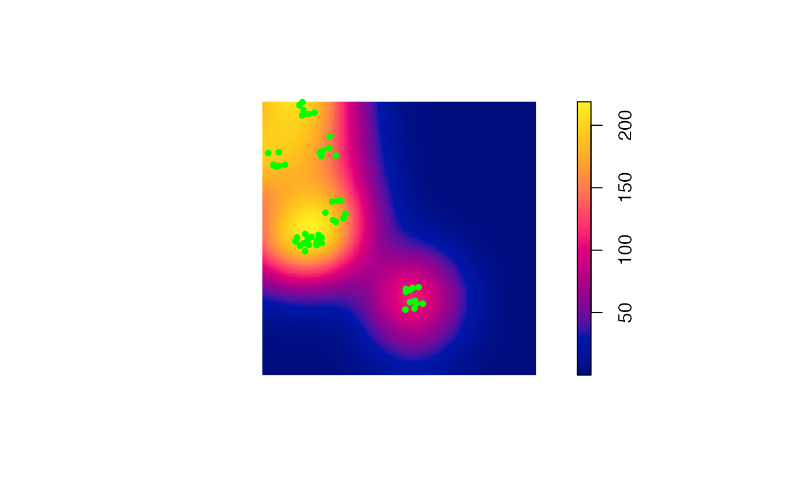

# Mapping local values of measures

Local values of distance-based measures of spatial concentration can be
mapped (Marcon and Puech (2023)).

## Dataset simulation

We build a point pattern made of cases (the points of interest) and
controls (the background distribution of points).

Cases are a Matérn (Matérn 1960) point pattern with $`\kappa`$
(expected) clusters of $`\mu`$ (expected) points in a circle of radius
*scale*. Controls are a Poisson point pattern whose density $`\lambda`$
decreases exponentially along the y-axis (we will call “north” the
higher y values).

``` r

library("dplyr")
library("dbmss")
# Simulation of cases (clusters)
rMatClust(kappa = 10, scale = 0.05, mu = 10) %>% 
  as.wmppp -> 
  CASES
marks(CASES)$PointType <- "Cases"
# Number of points
CASES$n
```

    ## [1] 54

``` r

# Simulation of controls (random distribution)
rpoispp(function(x, y) {1000 * exp(-2 * y)}) %>% 
  as.wmppp ->
  CONTROLS
marks(CONTROLS)$PointType <- "Controls"
# Number of points
CONTROLS$n
```

    ## [1] 427

``` r

# Mixed patterns (cases and controls)
ALL <- superimpose(CASES, CONTROLS)
autoplot(ALL)
```



### Calculate and plot *M* Cases

``` r

# Fix the number of simulations and the level of risk
NumberOfSimulations <- 1000
Alpha <- .01

# Calculate and plot M Cases
ALL %>% 
  MEnvelope(
    ReferenceType = "Cases", 
    SimulationType = "RandomLocation",
    NumberOfSimulations = NumberOfSimulations,
    Alpha = Alpha,
    Global = TRUE
  ) ->
  M_env_cases

autoplot(M_env_cases)
```



The plot shows a clear relative concentration of cases.

### Map *M* results

To plot the individual values of *M* around each case, a distance must
be chosen. Then, the function must be computed at this distance with
individual values. Finally, a map is produced by smoothing the
individual values and plotted.

``` r

# Choose the distance to plot
Distance <- 0.1

# Calculate the M values to plot
ALL %>% 
  Mhat(
    r = c(0, Distance),
    ReferenceType = "Cases",
    NeighborType = "Cases", 
    # Individual must be TRUE
    Individual = TRUE
  ) -> 
  M_TheoEx

# Map resolution
resolution <- 512

# Create a map by smoothing the local values of M
M_TheoEx_map <- Smooth(
  # First argument is the point pattern
  ALL, 
  # fvind contains the individual values of M
  fvind = M_TheoEx, 
  # Distance selects the appropriate distance in fvind
  distance = Distance,
  Nbx = resolution, Nby = resolution
)

# Plot the point pattern with values of M(Distance)
plot(M_TheoEx_map, main = "")
# Add the cases to the map
points(
  ALL[marks(ALL)$PointType == "Cases"],
  pch = 20, col = "green"
)
# Add contour lines
contour(M_TheoEx_map, add = TRUE)
```



We can see that cases are concentrated almost everywhere (local *M*
value above 1) because we chose a Matérn point pattern.

The areas with the higher relative concentration are located in the
north of the map because the controls are less dense there.

### Compare with the density of cases

The density of cases is plotted. High densities are *not* similar to
high relative concentrations in this example because the control points
are not homogeneously distributed.

``` r

plot(density(CASES), main = "")
points(
  ALL[marks(ALL)$PointType == "Cases"],
  pch = 20, col = "green"
)
```



## References

Marcon, Eric, and Florence Puech. 2023. “Mapping Distributions in
Non-Homogeneous Space with Distance-Based Methods.” *Journal of Spatial
Econometrics* 4 (1): 13. <https://doi.org/10.1007/s43071-023-00042-1>.

Matérn, Bertil. 1960. “Spatial Variation.” *Meddelanden Från Statens
Skogsforskningsinstitut* 49 (5): 1–144.
