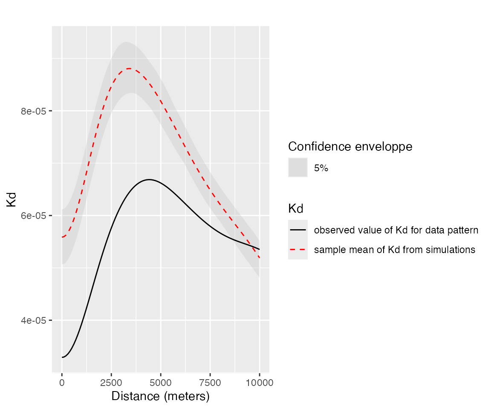
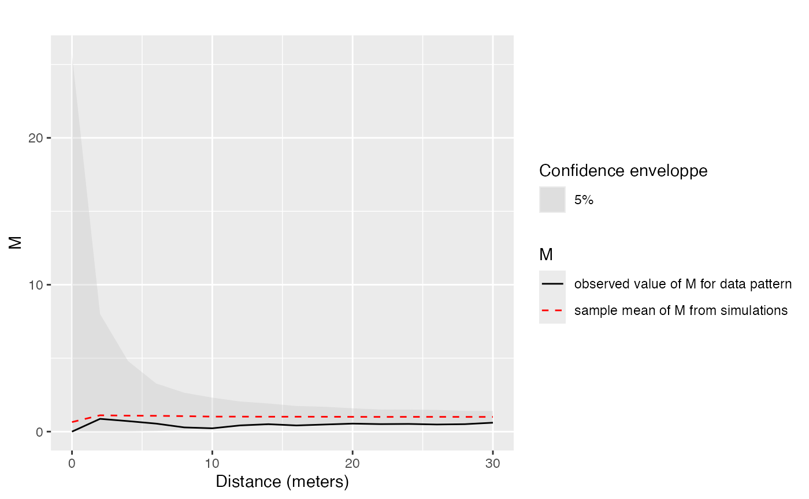

# dbmss Package Reference

The *dbmss* package allows simple computation of spatial statistic
functions of distance to characterize the spatial structures of mapped
objects, including classical ones (Ripley’s K and others) and more
recent ones used by spatial economists (Duranton and Overman’s $`K_d`$,
Marcon and Puech’s $`M`$). It relies on *spatstat* for some core
calculation.

This vignette contains its reference guide.

Characterizing spatial distributions of objects concerns numerous
researchers in various fields. Amongst many questions, ecologists have
been addressing the spatial attraction between species (Duncan 1991) or
the non-independence of the location of dead trees in a forest (Haase et
al. 1997). Analyzing the spatial distribution of plants, economists may
be concerned by the location of new entrants (Duranton and Overman 2008)
or by the location of shops according to the types of good sold (Picone
et al. 2009). In epidemiology, researchers want to identify the spatial
distribution of sick individuals in comparison to the population (Diggle
and Chetwynd 1991). In these fields of research, the point process
theory undoubtedly helps dealing with these questions. Exploratory
statistics of point patterns widely rely on Ripley’s seminal work
(Ripley 1976, 1977), namely the $`K`$ function. A review of similar
methods has been made by Marcon and Puech (2017) who called them
distance-based measures of spatial concentration. We will write spatial
structures here since both dispersion and concentration can be
characterized. They are considered as novel and promising tools in
spatial economics (Combes et al. 2008). The traditional approach to
detect localization, i.e. the degree of dissimilarity between the
geographical distribution of an industry and that of a reference (Hoover
1936), relies on discrete space (a country is divided in regions for
example) and measures of inequality between zones, such as the classical
Gini (1912) index or the more advanced Ellison and Glaeser (1997) index.
This approach suffers several limitations, mainly the Modifiable Areal
Unit Problem (MAUP): results depend on the way zones are delimited and
on the scale of observation (Openshaw and Taylor 1979). Distance-based
methods have the advantage to consider space as continuous, i.e. without
any zoning, allowing detecting spatial structures at all scales
simultaneously and solve MAUP issues.

These methods estimate the value of a function of distance to each point
calculated on a planar point pattern, typically objects on a map. They
all consist in counting *neighbors* (up to or exactly at the chosen
distance) around each *reference point* and transform their number into
a meaningful statistic. There are basically three possible approaches:
just count neighbors, count neighbors per surface area or calculate the
proportion of neighbors of interest among all neighbors. They define the
three families of functions: absolute (how many neighbors are there?),
topographic (how many neighbors per unit of area?) and relative (what is
the ratio of neighbors of interest?). The function values are not the
main motivation. The purpose is rather to test the point pattern against
the null hypothesis that it is a realization of a known point process
which does not integrate a property of interest. The basic purpose of
Ripley’s $`K`$ is to test the observed point pattern against complete
spatial randomness (CSR), i.e. a homogeneous Poisson process, to detect
dependence between point locations (the null hypothesis supposes
independent points) assuming homogeneity (i.e. the probability to find a
point is the same everywhere). Ripley-like functions, available in the
*dbmss* package, can be classified in three families:

- Topographic measures such as $`K`$ take space as their reference. They
  have been widely used in ecology (Fortin and Dale 2005). They have
  been built from the point process theory and have a strong
  mathematical background.
- Relative measures such as $`M`$(Marcon and Puech 2010) compare the
  structure of a point type to that of another type (they can be
  considered as cases and controls). They have been developed in
  economics, where comparing the distribution of a sector of activity to
  that of the whole economic activity is a classical approach (Combes et
  al. 2008), but introduced only recently in ecology (Marcon et al.
  2012).
- Absolute functions such as $`K_d`$(Duranton and Overman 2005) have no
  reference at all but their value can be compared to the appropriate
  null hypothesis to test it.

Relative and absolute functions have been built from descriptive
statistics of point patterns, not related to the underlying point
processes, so they are seen as heuristic and ignored by the statistical
literature (Illian et al. 2008). Topographic functions are implemented
in the *spatstat* package \[Baddeley and Turner (2005)} but absolute and
relative functions are missing. We fill this gap by proposing the
*dbmss* package. It makes the computation of the whole set of
distance-based methods simple for empirical researchers by introducing
measures that are not available elsewhere and wrapping some topographic
measures available in *spatstat* so that all can be used the same way.

Estimated values of the functions must be tested against a null
hypothesis. The usual empirical way to characterize a spatial structure
consists in computing the appropriate function and comparing it to the
quantiles of a large number of simulations of the null hypothesis to
reject (Kenkel 1988). We propose extended possibilities to evaluate
confidence envelopes, including *global envelopes* (Duranton and Overman
2005), a goodness-of-fit test (Diggle 2013) and an analytic test (Lang
and Marcon 2013; Marcon et al. 2013).

Definitions of all functions and formulas for their estimation can be
found in Marcon and Puech (2017) and are not repeated here, but they are
summarized in the statistical background section. Their implementation
is presented in the package content section.

## Rationale and statistical background

We consider a map of points which often represents establishments in
economic geography or trees in vegetation science. These points have two
marks: a type (an industrial sector, a species…) and a weight (a number
of employees, a basal area…). We want to apply to this point pattern a
variety of exploratory statistics which are functions of distance
between points, able to test the null hypothesis of independence between
point locations. These functions are either topographic, absolute or
relative. They can be interpreted as the ratio between the observed
number of neighbors and the expected number of neighbors if points where
located independently from each other. If reference and neighbor points
are of the same type, the functions are univariate, to study
concentration or dispersion. They are bivariate if the types differ, to
address the colocation of types. We detail this approach below.

### Topographic, homogeneous functions

Topographic, homogeneous functions are Ripley’s $`K`$ and its derivative
$`g`$. Their null hypothesis is a Poisson homogeneous process: rejecting
it means that the process underlying the observed pattern is either not
homogeneous or not independent. These functions are applied when
homogeneity is assumed so independence only is tested by comparing the
observed values of the function to their confidence envelope under CSR.
Bivariate functions are tested against the null hypothesis of random
labeling (points locations are kept unchanged but marks are
redistributed randomly) or population independence (the reference point
type is kept unchanged, the neighbor point type is shifted) following
Goreaud and Pélissier (2003). The random labeling hypothesis considers
that points preexist and their marks are the result of a process to test
(e.g. are dead trees independently distributed in a forest?). The
population independence one considers that points belong to two
different populations with their own spatial structure and wants to test
whether they are independent from each other.

Edge effect correction is compulsory to compute topographic functions:
points located close to boundaries have less neighbors because of the
lack of knowledge outside the observation window. The *spatstat* package
provides corrections following Ripley (1988), we use them.

### Topographic, inhomogeneous functions

$`K_{inhom}`$(Baddeley et al. 2000) is the generalization of $`K`$ to
inhomogeneous processes: it tests independence of points assuming the
intensity of the process is known. Empirically, it generally has to be
estimated from the data after assumptions on the way to do it relying on
the theoretical knowledge of the process. The null hypothesis (*random
position*) is that the pattern comes from an inhomogeneous Poisson
process of this intensity, which can be simulated. Applying
$`K_{inhom}`$ to a single point type allows using the *random location*
null hypothesis, following Duranton and Overman (2005): observed points
(with their marks) are shuffled among observed locations to test for
independence. Bivariate $`K_{inhom}`$ null hypotheses may be random
labeling or population independence as defined by Marcon and Puech
(2010): reference points are kept unchanged, other points are
redistributed across observed locations.

$`K_{mm}`$(Penttinen 2006; Penttinen et al. 1992) generalizes $`K`$ to
weighted points (weights are continuous marks of the points). Its null
hypothesis in *dbmss* is random location. Penttinen et al. (1992)
inferred the point process from the point pattern, and used the inferred
process to simulate the null hypothesis patterns. This requires advanced
spatial statistics techniques and knowledge about the process that is
generally not available. The random location hypothesis is a way to draw
null patterns simply, but ignoring the stochasticity of the point
process.

The $`D`$(Diggle and Chetwynd 1991) function compares the $`K`$ function
of points of interest (cases) to that of other points (controls). Its
null hypothesis is random labeling.

### Absolute functions

In their seminal paper, Duranton and Overman (Duranton and Overman 2005)
study the distribution of industrial establishments in Great Britain.
Every establishment, represented by a point, is characterized by its
position (geographic coordinates), its sector of activity (point type)
and its number of employees (point weight). The $`K_d`$ function
(Duranton and Overman 2005) is the probability density to find a
neighbor a given distance apart from a point of interest in a finite
point process. The $`K^{emp}`$ function integrates the weights of
points: it is the density probability to find an employee $`r`$ apart
from an employee of interest.

$`K_d`$ and $`K^{emp}`$ are absolute measures since their value is not
normalized by the measure of space or any other reference: for a
binomial process, $`K_d`$ increases proportionally to $`r`$ if the
window is large enough to ignore edge effects (the probability density
is proportional to the perimeter of the circle of radius $`r`$, Bonneu
and Thomas-Agnan 2015), then edge effects make it decrease to 0 when
$`r`$ becomes larger than the window’s size: it is a bell-shaped curve.
$`K_d`$ values are not interpreted but compared to the confidence
envelope of the null hypothesis, which is random location. Bivariate
functions null hypotheses are random labeling, following Duranton and
Overman (2005), i.e. point types are redistributed across locations
while weights are kept unchanged, or population independence (as for
$`K_{inhom}`$). It is not corrected for edge effects. $`K_d`$ was
designed to characterize the spatial structure of an economic sector,
comparing it to the distribution of the whole activity. From this point
of view, it has been considered as a relative function Marcon and Puech
(2010). We prefer to be more accurate and distinguish it from strict
relative functions which directly calculate a ratio or a difference
between the number of points of the type of interest and the total
number of points. What makes it relative is only its null hypothesis:
changing it for random location (that of univariate $`K_{inhom}`$) would
make univariate $`K_d`$ behave as a topographic function (testing
independence of the distribution supposing its intensity is that of the
whole activity).

$`K_d`$ is a leading tool in spatial economics. A great number of its
applications can be found in the literature that confirms the recent
interest for distance-based methods in spatial economics. A recent major
study can be found in Ellison et al. (2010).

### Relative functions

The univariate and bivariate $`M`$ function (Marcon and Puech 2010) are
the ratio of neighbors of interest up to distance $`r`$ normalized by
its value over the whole domain. Their null hypotheses are the same as
$`K_d`$’s. They do not suffer edge effects. Marcon and Puech (2010) show
that the $`M`$ function respect most of the axioms generally accepted as
the *good properties* to evaluate geographic concentration in spatial
economics (Combes and Overman 2004; Duranton and Overman 2005).

$`m`$(Lang et al. 2020) is the density function measuring the same ratio
as $`M`$, at distance $`r`$.

### Unification

Empirically, all estimators can be seen as variations in a unique
framework: neighbors of each reference point are counted, their number
is averaged and divided by a reference measure. Last, this average local
result is divided by its reference value, calculated over the whole
point pattern instead of around each point.

Choosing reference and neighbor point types allows defining univariate
or bivariate functions, counting neighbors up to or at a distance
defines cumulative or density functions, taking an area or a number of
points as the reference measure defines topographic or relative
functions. These steps are detailed for two functions to clarify them:
we focus on Ripley’s $`g`$ and Marcon and Puech’s $`M`$ bivariate
function. See Marcon and Puech (2017) for a full review.

Reference points are denoted $`x_i`$, neighbor points are $`x_j`$. For
density functions such as $`g`$, neighbors of $`x_i`$ are counted at a
chosen distance $`r`$:

``` math
n\left(x_i, r\right) = \sum_{j, i\ne j}{k\left(\left\|x_i - x_j\right\|, r\right)c\left(i, j\right)}
```

$`k(\left\|x_i - x_j\right\|,r)`$ is a kernel estimator, necessary to
evaluate the number of neighbors at distance $`r`$, and $`c(i,j)`$ is an
edge-effect correction (points located close to boundaries have less
neighbors because of the lack of knowledge outside the observation
window).

To compute the bivariate $`M`$ function, reference points are of a
particular type in a marked point pattern: $`x_i \in \mathcal{R}`$,
where $`\mathcal{R}`$ is the set of points of the reference type.
Neighbors of the chosen type are denoted $`x_j \in \mathcal{N}`$. In
cumulative functions such as $`M`$, neighbors are counted up to $`r`$:

``` math
n\left(x_i, r\right) = \sum_{x_j \in \mathcal{N}, i \ne j}{{\mathbf 1}\left(\left\|x_i - x_j\right\|\le r\right)w\left(x_j\right)}
```

Points can be weighted, $`w(x_j)`$ is the neighbor’s weight.

The number of neighbors is averaged then. $`n`$ is the number of
reference points:

``` math
\bar{n}\left(r\right) = \frac{1}{n}\sum_i{n\left(x_i, r\right)}
```

The average number of neighbors is compared to a reference measure. It
may be a measure of space (the perimeter of the circle of radius $`r`$
for $`g`$), defining topographic functions:

``` math
z\left(r\right) = 2 \pi r
```

It may also be the average number of neighbors of all types in a
relative function such as $`M`$:

``` math
z\left(r\right) = \frac{1}{n}\sum_{j, i \ne j}{{\mathbf 1}\left(\left\|x_i - x_j\right\|\le r\right) w\left(x_j\right)}
```

Finally, $`\frac{\bar{n}(r)}{z(r)}`$ is compared to the same ratio
computed on the whole window. For $`g`$:

``` math
\frac{\bar{n}_0}{z_0} = \frac{n - 1}{A}
```

$`A`$ is the area of the window, $`\bar{n}_0`$ and $`z_0`$ are the limit
values of $`\bar{n}(r)`$ and $`z(r)`$ when $`r`$ gets larger than the
window’s size. For $`M`$, it comes:

``` math
\frac{{\bar{n}}_0}{z_0} = \sum_i{\frac{W_\mathcal{N}}{W - w\left(x_i\right)}}
```

$`W_\mathcal{N}`$ is the total weight of neighbor points, $`W`$ that of
all points. Finally, despite the functions are quite different (density
vs. cumulative, topographic vs. relative, univariate vs. bivariate),
both estimators can be written as
$`{\frac{{\bar{n}}}{z}}/{\frac{{\bar{n}}_0}{z_0}}`$. Their value (except
for absolute functions) can be interpreted as a location quotient:
$`g(r)=2`$ or $`M(r)=2`$ means than twice more neighbors are observed at
(or up to) distance $`r`$ than expected on average, i.e. ignoring the
point locations in the window. The appropriate function will be chosen
among the toolbox according to the question raised.

## Package content

The *dbmss* package contains a full (within the limits of the literature
reviewed in section 2) set of functions to characterize the spatial
structure of a point pattern, including tools to compute the confidence
interval of the counterfactual. It allows addressing big datasets thanks
to C++ code used to calculate distances between pairs of points (using
*Rcpp* and *RcppParallel* infrastructure: Eddelbuettel and François
2011; Allaire et al. 2023). Computational requirements actually are an
issue starting from say 10,000 points (see Ellison et al. 2010 for
instance). Memory requirement is $`O(n)`$, i.e. proportional to the
number of points to store their location and type. We use loops to
calculate distances and increment summary statistics rather than store a
distance matrix which is $`O(n^2)`$, following Scholl and Brenner
(2015). Computation time is $`O(n^2)`$ because $`n(n-1)/2`$ pair
distances must be calculated.

We consider planar points patterns (sets of points in a 2-dimensional
space) with marks of a special kind: each point comes with a continuous
mark (its weight) and a discrete one (its type). We call this special
type of point pattern *weighted, marked, planar point patterns* and
define objects of class `wmppp`, which derives from `ppp` class as
defined in *spatstat*. Marks are a dataframe with two columns,
`PointWeight` containing the weights of points, and `PointTypes`
containing the types, as factors.

A `wmppp` object can be created by the
[`wmppp()`](https://ericmarcon.github.io/dbmss/dev/reference/wmppp.md)
function which accepts a dataframe as argument, or converted from a
`ppp` object by
[`as.wmppp()`](https://ericmarcon.github.io/dbmss/dev/reference/as.wmppp.md).
Starting from a csv file containing point coordinates, their type and
their weight in four columns, a `wmppp` object can be created by just
reading the file with
[`read.csv()`](https://rdrr.io/r/utils/read.table.html) and applying
[`wmppp()`](https://ericmarcon.github.io/dbmss/dev/reference/wmppp.md)
to the result. Options are available to specify the observation window
or guess it from the point coordinates and set default weights or types
to points when they are not in the dataframe, see the package help for
details. The simplest code to create a `wmppp` with 100 points is as
follows. It draws point coordinates between 0 and 1, and creates a
`wmppp` with a default window, all points are of the same type named
*All* and their weight is 1.

``` r

library("dbmss")
```

    ## Loading required package: Rcpp

    ## Loading required package: spatstat.explore

    ## Loading required package: spatstat.data

    ## Loading required package: spatstat.univar

    ## spatstat.univar 3.2-0

    ## Loading required package: spatstat.geom

    ## spatstat.geom 3.8-3

    ## Loading required package: spatstat.random

    ## spatstat.random 3.5-2

    ## Loading required package: nlme

    ## spatstat.explore 3.8-3

``` r

Pattern <- wmppp(data.frame(X = runif(100), Y = runif(100)))
summary(Pattern)
```

    ## Marked planar point pattern:  100 points
    ## Average intensity 102.9038 points per square unit
    ## 
    ## Coordinates are given to 16 decimal places
    ## 
    ## Mark variables: PointWeight, PointType
    ## Summary:
    ##   PointWeight PointType
    ##  Min.   :1    All:100  
    ##  1st Qu.:1             
    ##  Median :1             
    ##  Mean   :1             
    ##  3rd Qu.:1             
    ##  Max.   :1             
    ## 
    ## Window: rectangle = [0.004359, 0.9922431] x [0.0029645, 0.9866648] units
    ##                     (0.9879 x 0.9837 units)
    ## Window area = 0.971782 square units

### Distance-based functions

All functions are named `Xhat` where `X` is the name of the function:

- Ripley’s $`g`$ and $`K`$, and $`K`$’s normalization, Besag’s
  $`L`$(1977);
- Penttinen’s $`K_{mm}`$ and $`L_{mm}`$;
- Diggle and Chetwynd’s $`D`$;
- Baddeley et al.’s $`K_{inhom}`$ and its derivative $`g_{inhom}`$;
- Marcon and Puech’s $`M`$;
- Duranton and Overman’s $`K_d`$ (including its weighted version
  $`K^{emp}`$).

The suffix `hat` has been used to avoid confusion with other functions
in R: `D` exists in the *stats* package for example.

Arguments are:

- A weighted, marked planar point pattern (a `wmppp` class object). The
  window can be a polygon or a binary image, as in *spatstat*.
- A vector of distances.
- Optionally a reference and a neighbor point type to calculate
  bivariate functions, or equivalently the types of cases and controls
  for the $`D`$ function.
- Some optional arguments, specific to some functions.

Topographic functions require edge-effect corrections, provided by
*spatstat*: the `best` correction is systematically used. Relative
functions ignore the window. Technical details are provided in help
files.

These functions return an `fv` object, as defined in *spatstat*, which
can be plotted.

### Confidence envelopes

The classical confidence intervals, calculated by Monte-Carlo
simulations (Kenkel 1988) are obtained by the `XEnvelope` functions,
where `X` is the function’s name. Arguments are the number of
simulations to run, the risk level, those of the function and the null
hypothesis to simulate. These functions return a `dbmssEnvelope` object
which can be plotted.

Null hypotheses have been discussed by Goreaud and Pélissier (2003) for
topographic functions such as $`K`$ and by Marcon and Puech (2010) for
relative functions. The null hypothesis for univariate functions is
random position (points are drawn in a Poisson process for topographic
functions) or random location (points are redistributed across actual
locations for relative functions). Bivariate functions support random
labeling and population independence null hypotheses. The possible
values of arguments are detailed in the help file of each function.

Building a confidence envelope this way is problematic because the test
is repeated at each distance. The underestimation of the risk has been
discussed by Loosmore and Ford (2006). Duranton and Overman (2005)
proposed a global envelope computed by the repeated elimination of
simulations reaching an extreme value at any distance until the desired
level is reached. The argument `Global = TRUE` is used to obtain it
instead of the local one.

### Examples

We illustrate the main features of the package by two examples. The
first one comes from the economic literature (Bonneu 2007) [^1]

``` r

load("CSBIGS.Rdata")
Category <- cut(
  Emergencies$M, 
  quantile(Emergencies$M, probs = c(0, 0.9, 1)),
  labels = c("Other", "Biggest"), 
  include.lowest = TRUE
)
X <- wmppp(
  data.frame(X = Emergencies$X, Y = Emergencies$Y, PointType = Category), 
  win = Region
)
X$window$units <- c("meter","meters")
X2 <- split(X)
marks(X2$Other) <- rep(1, X2$Other$n)
marks(X2$Biggest) <- rep(1, X2$Biggest$n)
par(mfrow = c(1, 2), mar = c(0, 0, 0, 0))  
plot(X2$Other, main = "", maxsize = 1, legend = FALSE)
text(514300, 1826800, "a")
plot(X2$Biggest, main = "", maxsize = 1, legend = FALSE)
text(514300, 1826800, "b")
```


``` r

par(mfrow = c(1, 1))
```

The map of emergencies in the urban area of Toulouse, France, during
year 2004 (about 33 km from south to north) shows (a) 20,820 emergencies
recorded (many points are confused at the figure scale) and (b) the
locations of the 10 percent most serious ones. The workload associated
to each emergency (the number of men $`\times`$ hours it required) is
known. The original study tested the dependence between workload and
location of emergencies: it did not exclude the null hypothesis of
random labeling. We have a complementary approach here: we consider the
10 percent more serious emergencies, i.e. those which caused the highest
workload. $`K_d`$ may detect concentration (or dispersion) if, at a
distance $`r`$ from a serious emergency, the probability to find another
serious emergency is greater (or lower) than that of finding an
emergency whatever its workload:

The `Emergencies` data frame contains point coordinates (in meters) in
columns `X` and `Y` and workload in column `M`. The second line of the
code creates a vector containing a factor describing the workload to
separate its 10% higher values. A `wmppp` object is created then,
containing the points and their mark. The `KdEnvelope` function is run
from 0 to 10km by steps of 100m for the most serious emergencies. The
figure below shows that the 10% most serious emergencies are more
dispersed than the distribution of all emergencies at all distances up
to 10km.

``` r

KdE <- KdEnvelope(
  X, 
  r = seq(0, 10000, 100), 
  NumberOfSimulations = 1000, 
  ReferenceType = "Biggest", 
  Global = TRUE
)
autoplot(KdE, main = "")
```



The solid, black curve is $`K_d`$. The dotted red curve is the average
simulated value and the shaded area is the confidence envelope under the
null hypothesis of random location. The risk level is 5%, 1000
simulations have been run. distances are in meters.

This opens the way to discuss on the optimal location of fire stations.

The second example uses the `paracou16` point pattern provided in the
package. It represents the distribution of trees in a 4.1-ha tropical
forest plot in the Paracou field station in French Guiana
(Gourlet-Fleury et al. 2004). It contains 2426 trees, whose species is
either *Qualea rosea*, *Vouacapoua americana* or Other (one of more than
300 species). Weights are basal areas (the area of the stems virtually
cut 1.3 meter above ground), measured in square centimeters.

``` r

autoplot(
  paracou16,
  labelSize = expression("Basal area (" ~cm^2~ ")"), 
  labelColor = "Species"
)
```

On the map, circles are centered on trees in the forest plot (the
containing rectangle is 200m wide by 250m long). Circle sizes are
proportional to the basal areas of trees.

The question to test is dependence between the distributions of the two
species of interest. Bivariate $`M(r)`$ is calculated for $`r`$ between
0 and 30 meters. 1000 simulations are run to build the global confidence
envelope.

``` r

Envelope <- MEnvelope(
  paracou16, 
  r = seq(0, 30, 2), 
  NumberOfSimulations = 1000,
  Alpha = 0.05, 
  ReferenceType = "V. Americana", 
  NeighborType = "Q. Rosea", 
  SimulationType = "RandomLabeling", 
  Global = TRUE
)
autoplot(Envelope, main = "", ylim = c(0, 20))
```



$`M(r)`$ values of *Qualea rosea* around *Vouacapoua Americana* are
plotted. The solid, black curve is $`M`$. The dotted red curve is the
average simulated value. The shaded area is the confidence envelope.
$`M=1`$ is expected if points are independently distributed. The risk
level is 5%, 1000 simulations have been run. Distances are in meters.

The calculated function is $`M`$, showing the repulsion between *V.
Americana* and *Q. rosea* up to 30 m. Significance is unclear, since the
observed values of the function are very close to the lower bound of the
envelope. The complete study, with a larger dataset allowing significant
results, can be found in Marcon et al. (2012).

### Goodness-of-fit test

A Goodness-of-fit test for $`K`$ has been proposed by Diggle (2013),
applied to $`K`$ by Loosmore and Ford (2006) and to $`M`$ by Marcon et
al. (2012). It calculates the distance between the actual values of the
function and its average value obtained in simulations of the null
hypothesis. The same distance is calculated for each simulated point
pattern, and the returned $`p`$-value of the test if the ratio of
simulations whose distance is larger than that of the real point
pattern. The test is performed by the `GoFtest` function whose argument
is the envelope previously calculated (actually, the function uses the
simulation values).

Applied to the example of Paracou trees, the $`p`$-value is:

``` r

GoFtest(Envelope)
```

    ## [1] 0.011

### Ktest

The `Ktest` has been developed by Lang and Marcon (Lang and Marcon 2013;
Marcon et al. 2013). It does not rely on simulations and returns the
$`p`$-value to erroneously reject complete spatial randomness (CSR)
given the values of $`K`$. It relies on the exact variance of $`K`$
calculated with edge-effect corrections. It only works in a rectangular
window.

The following example tests a 1.5-ha subset of `paracou16` (100m by
150m, origin at the southwestern corner).

``` r

data("paracou16")
RectWindow <- owin(c(300, 400), c(0, 150))
X <- paracou16[RectWindow]
(pKtest <- Ktest(X, seq(5, 50, 5)))
```

    ## [1] 0.002682576

It rejects CSR (p=0.0027).

## References

Allaire, JJ, Romain Francois, Kevin Ushey, Gregory Vandenbrouck, Marcus
Geelnard, and Intel. 2023. *RcppParallel: Parallel Programming Tools for
’Rcpp’*. Manual.

Baddeley, Adrian J., Jesper Møller, and Rasmus Plenge Waagepetersen.
2000. “Non- and Semi-Parametric Estimation of Interaction in
Inhomogeneous Point Patterns.” *Statistica Neerlandica* 54 (3): 329–50.
<https://doi.org/10.1111/1467-9574.00144>.

Baddeley, Adrian J., and Rolf Turner. 2005. “Spatstat: An R Package for
Analyzing Spatial Point Patterns.” *Journal of Statistical Software* 12
(6): 1–42. <https://doi.org/10.18637/jss.v012.i06>.

Besag, Julian E. 1977. “Comments on Ripley’s Paper.” *Journal of the
Royal Statistical Society: Series B (Statistical Methodology)* 39 (2):
193–95. <https://doi.org/10.1111/j.2517-6161.1977.tb01616.x>.

Bonneu, Florent. 2007. “Exploring and Modeling Fire Department
Emergencies with a Spatio-Temporal Marked Point Process.” *Case Studies
in Business, Industry and Government Statistics* 1 (2): 139–52.

Bonneu, Florent, and Christine Thomas-Agnan. 2015. “Measuring and
Testing Spatial Mass Concentration with Micro-geographic Data.” *Spatial
Economic Analysis* 10 (3): 289–316.
<https://doi.org/10.1080/17421772.2015.1062124>.

Combes, Pierre-Philippe, Thierry Mayer, and Jacques-François Thisse.
2008. “Economic Geography.” In *The Integration of Regions and Nations*.
Princeton University Press.

Combes, Pierre-Philippe, and Henry G Overman. 2004. “The Spatial
Distribution of Economic Activities in the European Union.” Chap. 64 in
*Handbook of Urban and Regional Economics*, edited by J Vernon Henderson
and Jacques-François Thisse, vol. 4. Elsevier. North Holland.

Diggle, Peter J. 2013. *Statistical Analysis of Spatial and
Spatio-Temporal Point Patterns*. 3rd Editio. Chapman and Hall/CRC.

Diggle, Peter J., and A. G. Chetwynd. 1991. “Second-Order Analysis of
Spatial Clustering for Inhomogeneous Populations.” *Biometrics* 47 (3):
1155–63. <https://doi.org/10.2307/2532668>.

Duncan, Richard P. 1991. “Competition and the Coexistence of Species in
a Mixed Podocarp Stand.” *Journal of Ecology* 79 (4): 1073–84.
<https://doi.org/10.2307/2261099>.

Duranton, Gilles, and Henry G Overman. 2005. “Testing for Localisation
Using Micro-Geographic Data.” *Review of Economic Studies* 72 (4):
1077–106. <https://doi.org/10.1111/0034-6527.00362>.

Duranton, Gilles, and Henry G Overman. 2008. “Exploring the Detailed
Location Patterns of UK Manufacturing Industries Using Microgeographic
Data.” *Journal of Regional Science* 48 (1): 213–43.
<https://doi.org/10.1111/j.1365-2966.2006.0547.x>.

Eddelbuettel, Dirk, and Romain François. 2011. “Rcpp: Seamless R and C++
Integration.” *Journal of Statistical Software* 40 (8): 1–18.
<https://doi.org/10.18637/jss.v040.i08>.

Ellison, Glenn, and Edward L Glaeser. 1997. “Geographic Concentration in
U.S. Manufacturing Industries: A Dartboard Approach.” *Journal of
Political Economy* 105 (5): 889–927. <https://doi.org/10.1086/262098>.

Ellison, Glenn, Edward L Glaeser, and William R Kerr. 2010. “What Causes
Industry Agglomeration? Evidence from Coagglomeration Patterns.” *The
American Economic Review* 100 (3): 1195–213.
<https://doi.org/10.1257/aer.100.3.1195>.

Fortin, Marie-Josée, and Mark R T Dale. 2005. *Spatial Analysis. A Guide
for Ecologists.* Cambridge University Press.

Gini, Corrado. 1912. *Variabilità e Mutabilità*. C. Cuppini.

Goreaud, François, and Raphaël Pélissier. 2003. “Avoiding
Misinterpretation of Biotic Interactions with the Intertype K12
Function: Population Independence Vs Random Labelling Hypotheses.”
*Journal of Vegetation Science* 14 (5): 681–92.
<https://doi.org/10.1111/j.1654-1103.2003.tb02200.x>.

Gourlet-Fleury, Sylvie, Jean Marc Guehl, and Olivier Laroussinie. 2004.
*Ecology & Management of a Neotropical Rainforest. Lessons Drawn from
Paracou, a Long-Term Experimental Research Site in French Guiana*.
Elsevier.

Haase, Peter, Francisco I. Pugnaire, S. C. Clark, and L. D. Incoll.
1997. “Spatial Pattern in Anthyllis Cytisoides Shrubland on Abandoned
Land in Southeastern Spain.” *Journal of Vegetation Science* 8 (5):
627–34.

Hoover, Edgar M. 1936. “The Measurement of Industrial Localization.”
*The Review of Economics and Statistics* 18 (4): 162–71.

Illian, Janine, Antti Penttinen, Helga Stoyan, and Dietrich Stoyan.
2008. *Statistical Analysis and Modelling of Spatial Point Patterns*.
Statistics in Practice. Wiley-Interscience.

Kenkel, N. C. 1988. “Pattern of Self-Thinning in Jack Pine: Testing the
Random Mortality Hypothesis.” *Ecology* 69 (4): 1017–24.
<https://doi.org/10.2307/1941257>.

Lang, Gabriel, and Eric Marcon. 2013. “Testing Randomness of Spatial
Point Patterns with the Ripley Statistic.” *ESAIM: Probability and
Statistics* 17: 767–88. <https://doi.org/10.1051/ps/2012027>.

Lang, Gabriel, Eric Marcon, and Florence Puech. 2020. “Distance-Based
Measures of Spatial Concentration: Introducing a Relative Density
Function.” *The Annals of Regional Science* 64: 243–65.
<https://doi.org/10.1007/s00168-019-00946-7>.

Loosmore, N. B., and E. D. Ford. 2006. “Statistical Inference Using the
G or K Point Pattern Spatial Statistics.” *Ecology* 87 (8): 1925–31.
<https://doi.org/10.1890/001>.

Marcon, Eric, and Florence Puech. 2010. “Measures of the Geographic
Concentration of Industries: Improving Distance-Based Methods.” *Journal
of Economic Geography* 10 (5): 745–62.
<https://doi.org/10.1093/jeg/lbp056>.

Marcon, Eric, and Florence Puech. 2017. “A Typology of Distance-Based
Measures of Spatial Concentration.” *Regional Science and Urban
Economics* 62: 56–67.
<https://doi.org/10.1016/j.regsciurbeco.2016.10.004>.

Marcon, Eric, Florence Puech, and Stéphane Traissac. 2012.
“Characterizing the Relative Spatial Structure of Point Patterns.”
*International Journal of Ecology* 2012: 619281.
<https://doi.org/10.1155/2012/619281>.

Marcon, Eric, Stéphane Traissac, and Gabriel Lang. 2013. “A Statistical
Test for Ripley’s Function Rejection of Poisson Null Hypothesis.” *ISRN
Ecology* 2013 (Article ID 753475): 9.
<https://doi.org/10.1155/2013/753475>.

Openshaw, S., and P. J. Taylor. 1979. “A Million or so Correlation
Coefficients: Three Experiments on the Modifiable Areal Unit Problem.”
In *Statistical Applications in the Spatial Sciences*, edited by N
Wrigley. Pion.

Penttinen, Antti. 2006. “Statistics for Marked Point Patterns.” In *The
Yearbook of the Finnish Statistical Society*. The Finnish Statistical
Society.

Penttinen, Antti, Dietrich Stoyan, and Helena M Henttonen. 1992. “Marked
Point Processes in Forest Statistics.” *Forest Science* 38 (4): 806–24.
<https://doi.org/10.1093/forestscience/38.4.806>.

Picone, Gabriel A., David B. Ridley, and Paul A. Zandbergen. 2009.
“Distance Decreases with Differentiation: Strategic Agglomeration by
Retailers.” *International Journal of Industrial Organization* 27 (3):
463–73.

Ripley, Brian D. 1976. “The Second-Order Analysis of Stationary Point
Processes.” *Journal of Applied Probability* 13 (2): 255–66.
<https://doi.org/10.2307/3212829>.

Ripley, Brian D. 1977. “Modelling Spatial Patterns.” *Journal of the
Royal Statistical Society: Series B (Statistical Methodology)* 39 (2):
172–212. <https://doi.org/10.1111/j.2517-6161.1977.tb01615.x>.

Ripley, Brian D. 1988. *Statistical Inference for Spatial Processes*.
Cambridge University Press.

Scholl, Tobias, and Thomas Brenner. 2015. “Optimizing Distance-Based
Methods for Large Data Sets.” *Journal of Geographical Systems* 17 (4):
333–51. <https://doi.org/10.1007/s10109-015-0219-1>.

[^1]: The dataset can be downloaded from
    <http://publications-sfds.fr/index.php/csbigs/article/downloadSuppFile/376/69>
